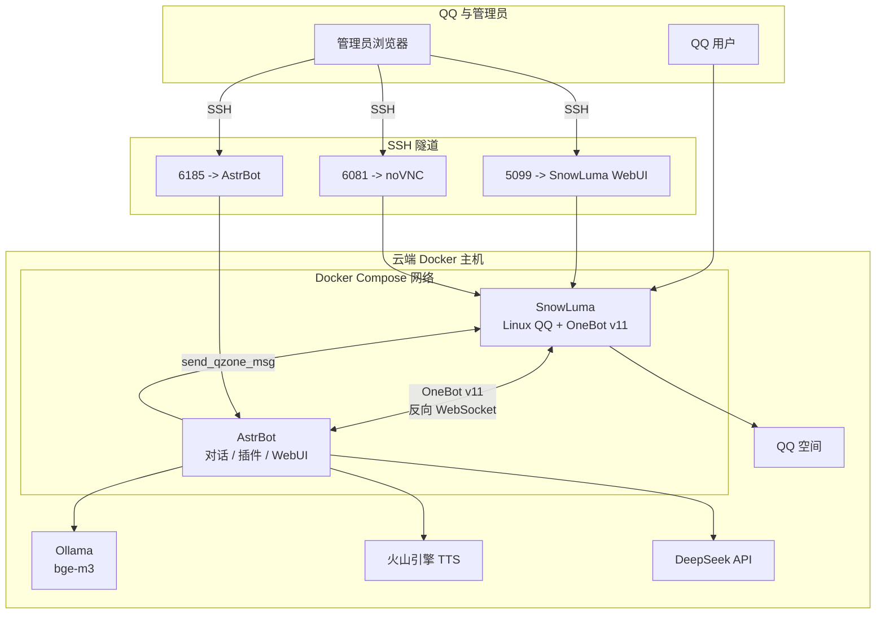
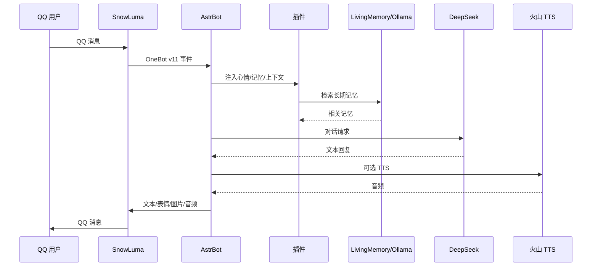

# 体系结构

## 1. 总览



## 2. 组件职责

### SnowLuma

- 运行真实 Linux QQ 客户端
- 通过 OneBot v11 向 AstrBot 提供消息与动作
- 通过 noVNC 提供扫码和远程桌面
- 提供 `send_qzone_msg` / `delete_qzone_msg` 等 QQ 空间扩展动作
- 不直接暴露到公网；WebUI 和 noVNC 只绑定回环地址

### AstrBot

- 接收 OneBot 事件，调度人格、模型和插件
- 提供 WebUI 与插件管理
- 负责对话、TTS、长期记忆、媒体发送和定时任务
- 通过 Docker Volume 持有运行时数据 `data/`

### 插件层

| 插件 | 职责 |
|---|---|
| `astrbot_plugin_dafeiyu_heart` | 关系、心情底色、动态心情、心绪手札 |
| `astrbot_plugin_dafeiyu_memory2` | 日记 2.0、主人画像、短期日程 |
| `astrbot_plugin_dafeiyu_ripple` | 涟漪记忆：日常碎事的衰减记忆池 |
| `astrbot_plugin_dafeiyu_owner` | `/认主` 绑定主人，写入插件配置和 AstrBot 管理员列表 |
| `astrbot_plugin_dafeiyu_drawer` | 表情包收藏、主人小事实时记录与注入 |
| `astrbot_plugin_dafeiyu_ears` | 本地音乐点歌、听歌、分享歌曲 |
| `astrbot_plugin_dafeiyu_context` | 折叠长上下文，降低 token |
| `astrbot_plugin_livingmemory` | 长期记忆、反思、向量检索、记忆工具 |
| `astrbot_plugin_face_convert` | 文字表情 → QQ 原生表情，媒体入站翻译，语音开关 |
| `astrbot_plugin_dafeiyu_social` | 发图、原生表情、表情包、相册、QQ 空间动态、自动动态、自动表情包 |
| `astrbot_plugin_dafeiyu_moodface` | 根据心情给部分回复附加原生表情 |

### 模型与数据

| 服务 | 用途 | 数据边界 |
|---|---|---|
| DeepSeek | 文本对话 | 对话内容经 API 发送 |
| 火山引擎 Seed-TTS | 语音合成 | 文本发送至 TTS API |
| Ollama `bge-m3` | 记忆向量、涟漪相似度 | 记忆文本在本地服务器内处理 |
| LivingMemory SQLite | 长期记忆 | 只存于 `data/plugin_data` |
| 涟漪 SQLite | 碎事记忆池 | 只存于 `data/plugin_data` |
| 相册 SQLite + 文件 | 照片和备注 | 只存于 `data/plugin_data` |
| AstrBot SQLite | 会话、消息、人格 | 只存于 `data/` |

## 3. 消息流



## 4. 分段与媒体

- `respond_stage.py` 补丁支持按中文句号切分消息
- 每段之间有 0.8–1.8 秒随机间隔
- 原生表情可标记为：
  - 独立消息，在对话后发送
  - 内联到最后一段文字末尾
- 表情包作为独立 `Image` 消息发送，不塞进文字气泡
- 自动表情包与自动原生表情都由 `on_decorating_result` 注入

## 4.1 涟漪记忆与相册

涟漪记忆是一条会衰减的曲线，不是数据库检索：

```text
保留度 = exp(-经过天数 / 记忆尺度)
```

| 区间 | 含义 | 行为 |
|---|---|---|
| > 0.62 | 新鲜 | 太清楚，不主动提 |
| 0.16 – 0.62 | 中部 | 命中关键词、重复 4 字或语义相近时模糊想起 |
| < 0.16 | 沉底 | 不再想起；重新被提到才勾回中部 |

- 想起一次：尺度 ×1.75，回到新鲜区（间隔重复）
- 勾回中部：把 `touched_at` 前移，使保留度正好落在 0.45，本轮不触发
- 冷却：同一 `umo` 90 分钟内只允许一次想起
- 同 `umo` 隔离，群体记忆不会串到私聊

相册写在社交插件自己的库里：

```text
data/plugin_data/astrbot_plugin_dafeiyu_social/
├── album.db                 # 编号、sha256、备注
└── album/YYYYMM/<hash>.png  # 照片原文件
```

- 入站图片按 sha256 去重
- 单张大小、相册总量都有上限
- 群友发图不入库，只收管理员私聊
- 备注只存一句话，不索引图片内容

## 5. 数据流与隐私边界

```text
data/
├── cmd_config.json          # 平台、Provider、密钥（不提交）
├── data_v4.db               # 会话与历史（不提交）
├── config/                  # 插件配置（不提交）
├── plugin_data/             # 记忆、心绪、日记、画像（不提交）
├── logs/                    # 日志（不提交）
└── snowluma/                # QQ 登录态、OneBot 配置（不提交）
```

公开仓库只保存：

- 插件源码
- 补丁源码
- Compose / Dockerfile
- 公开人格模板
- 公共表情包素材
- 配置示例和文档

## 6. 部署边界

- AstrBot / SnowLuma WebUI 仅绑定 `127.0.0.1`
- SnowLuma noVNC 仅绑定 `127.0.0.1`
- OneBot 3000/3001 不映射到宿主机
- Ollama 仅监听 Docker 网关
- 管理员通过 SSH 隧道访问面板
- 公网只需要 SSH 端口

## 7. 扩展点

- 新增插件：放入 `plugins/`，挂载到 `/AstrBot/data/plugins`
- 新增 Provider：在 AstrBot WebUI 配置
- 新增表情包：放入 `assets/stickers/dafeiyu/` 并更新 `catalog.json`
- 新增核心补丁：放入 `patches/`，在 `Dockerfile.astrbot` 中 `COPY`
- 新增动态/媒体能力：优先通过 OneBot v11 动作实现，避免侵入核心
