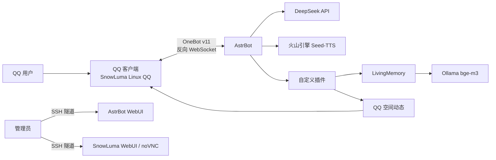

# 大肥鱼 QQ 机器人 · 云端版

> **使用声明**
>
> 本项目仅供个人学习、研究和个人非商业使用，不提供商业授权。
> 项目中涉及的第三方角色、声音、表情包、模型、代码和素材版权归各自原作者所有。
> 如权利人认为本项目内容侵权，请通过本仓库 Issue 联系，核实后将立即删除相关内容。
> 本项目与腾讯、DeepSeek、火山引擎、AstrBot、SnowLuma 等不存在隶属或官方授权关系。
>
> 详细声明见 [DISCLAIMER.md](DISCLAIMER.md)。

一只住在 QQ 里的蓝色鲸鱼娘。她可以聊天、发语音、发表情包、记住重要的事，
也可以在 QQ 空间写一条不泄露隐私的日常动态。

这个仓库整理的是当前可运行版本的**功能代码、插件和部署骨架**，不包含任何
个人 API Key、QQ 号、聊天记录、记忆数据库、登录二维码或服务器凭据。

## 功能

### 对话与人格

- DeepSeek 文本对话
- 自定义人格提示词
- 按中文句号分段发送，模拟自然聊天节奏
- 根据当前心情附加 QQ 原生小黄脸
- 表情包按心情、语境和氛围自动匹配
- 群聊 / 私聊 / 唤醒词由 AstrBot 平台配置控制

### 语音

- 火山引擎豆包 Seed-TTS（声音复刻 2.0）
- 自定义克隆音色
- 当前会话默认只回文字，发送 `/语音开` 后文字 + 语音
- `/语音关`、`/语音状态`
- 支持使用 FeiyuVoice 参考音色重新训练云端音色

### 长期记忆

- LivingMemory 长期记忆插件
- Ollama `bge-m3` 1024 维向量检索
- 记忆重要性、时间衰减、反思总结
- 按会话隔离，避免把不同私聊/群聊的记忆混在一起

### 记忆 2.0

- 日记 2.0：模糊化、延长、升档/降档、搁置、回收站
- 主人画像
- 短期日程表
- 定时结算窗口

### 心脏模块

- 关系认知
- 心情底色与动态心情
- 心绪手札
- 心情影响记忆召回和说话方式

### 媒体与表情包

- `/发图`
- `/表情`
- `/表情包`
- 100 张 Feiyu 风格 GIF 表情包
- 自动表情包：30% 触发，单次最多 2 条，永不连续 3 条
- 自动原生表情：约 50% 触发，其中一半跟随最后一段文字，一半独立发送
- 表情包/表情/图片独立成消息，不塞进文字气泡

### QQ 空间动态

- 手动发布文字/多图动态
- 权限支持公开、好友、私密
- `/动态查` 查询最近说说
- `/动态删` 删除最新动态
- `/动态预览` 预览自动生成的动态
- 每日自动动态：读取前一天 LivingMemory 的重要记忆，隐私过滤后发布
- 默认每天 09:30，默认好友可见，必要时可配置为私密

### 部署与安全

- Docker Compose 管理 AstrBot + SnowLuma
- SnowLuma 使用真实 Linux QQ，支持 OneBot v11
- WebUI 和 noVNC 只绑定 `127.0.0.1`，通过 SSH 隧道访问
- Ollama 只监听 Docker 网关，不直接暴露公网
- 日志轮转、非 root 容器运行、seccomp/ptrace 按 SnowLuma 要求配置

## 技术栈

| 层 | 技术 |
|---|---|
| 机器人框架 | AstrBot 4.29.3 |
| QQ 协议端 | SnowLuma（Linux QQ + Xvfb + noVNC + OneBot v11） |
| 对话模型 | DeepSeek |
| 语音合成 | 火山引擎豆包 Seed-TTS / 声音复刻 2.0 |
| 语音音色 | FeiyuVoice-CosyVoice3 参考音色（云端复刻版本） |
| 向量模型 | Ollama `bge-m3` |
| 长期记忆 | LivingMemory |
| 插件语言 | Python 3.10+（运行时 3.12） |
| 数据 | SQLite / aiosqlite |
| 编排 | Docker Compose |
| 部署 | Ubuntu 22.04 / systemd / UFW / SSH 隧道 |

## 架构



更详细的组件边界、数据流和插件职责见 [ARCHITECTURE.md](ARCHITECTURE.md)。

## 仓库结构

```text
.
├── docker-compose.yml            # AstrBot + SnowLuma
├── Dockerfile.astrbot            # 带核心补丁的 AstrBot 镜像
├── patches/
│   ├── volcengine_tts.py         # 豆包 Seed-TTS v3 适配
│   ├── session_llm_manager.py    # 默认关闭 TTS，/语音开 开启
│   └── respond_stage.py          # 分段发送 + 内联原生表情
├── plugins/
│   ├── astrbot_plugin_dafeiyu_heart/
│   ├── astrbot_plugin_dafeiyu_memory2/
│   ├── astrbot_plugin_dafeiyu_context/
│   ├── astrbot_plugin_dafeiyu_social/
│   ├── astrbot_plugin_dafeiyu_moodface/
│   ├── astrbot_plugin_face_convert/
│   └── astrbot_plugin_livingmemory/
├── persona/
│   └── dafeiyu.md                # 已移除私人信息的公开人格模板
├── config/
│   ├── snowluma-onebot.example.json
│   ├── social.example.json
│   └── CONFIGURATION.md
├── assets/stickers/dafeiyu/      # 100 张 GIF 及分类目录
└── scripts/
```

## 快速开始

### 1. 准备环境

- Linux 服务器或本机 Docker
- Docker Compose
- 可选：Ollama、DeepSeek API、火山引擎 TTS、SnowLuma

### 2. 启动

```bash
cp .env.example .env
# 修改 .env 中的 VNC 密码
bash scripts/install.sh
```

首次启动后：

1. 打开 AstrBot WebUI：`http://127.0.0.1:6185`
2. 新建 OneBot v11 平台，建议 ID 使用 `napcat`
3. 反向 WebSocket 地址填 `0.0.0.0:6199`，设置一个 token
4. 配置 DeepSeek、TTS、Ollama 等 provider
5. 按 [CONFIGURATION.md](config/CONFIGURATION.md) 配置插件管理员和 UMO
6. 打开 SnowLuma WebUI：`http://127.0.0.1:5099`
7. 通过 noVNC 扫码登录 QQ
8. 将 SnowLuma 的 `onebot.json` token 改成与 AstrBot 平台 token 一致

### 3. 导入人格

把 [persona/dafeiyu.md](persona/dafeiyu.md) 的正文导入 AstrBot 人格设置。

### 4. 初始化记忆和向量模型

```bash
ollama pull bge-m3
```

并将 AstrBot 的 embedding provider 指向：

```text
http://host.docker.internal:11434
```

具体配置见 [CONFIGURATION.md](config/CONFIGURATION.md)。

## 命令

完整命令见 [COMMANDS.md](COMMANDS.md)。常用命令：

```text
/语音开        开启当前会话语音
/语音关        关闭当前会话语音
/心            查看心情与关系
/手札          查看心绪手札
/日记2         查看日记
/画像          查看主人画像
/日程          查看日程
/上下文        查看最近上下文
/发图          发送图片
/表情          发送 QQ 原生表情
/表情包        发送表情包
/动态          发布 QQ 空间动态
/动态预览      预览自动动态
/动态自动      查看自动动态配置
```

## 仓库不包含的依赖

- AstrBot 和 SnowLuma 的完整源码：使用官方镜像
- FeiyuVoice-CosyVoice3 的 7.4GB 本地权重：当前部署使用云端声音复刻
- Ollama 模型文件：通过 `ollama pull bge-m3` 获取
- 任何真实账号、密钥、聊天记录或记忆数据库

## 数据与隐私

这个仓库**不包含**：

- DeepSeek / 火山引擎 / 其他 API Key
- QQ 号、管理员账号、UMO、token
- `data_v4.db`、聊天记录、LivingMemory 数据库
- `plugin_data`、日记、画像、日程、心绪手札
- 登录二维码、语音样本、日志、截图
- 个人服务器 IP、SSH 密钥、密码

运行时数据全部放在 `data/`，该目录已被 `.gitignore` 排除。详见
[PRIVACY.md](PRIVACY.md)。

## 第三方组件与许可

本项目原创代码和文档采用**个人非商业使用许可**，不允许商业使用；具体见
[LICENSE](LICENSE) 和 [DISCLAIMER.md](DISCLAIMER.md)。AstrBot、SnowLuma、
LivingMemory、FeiyuVoice、表情包素材等第三方组件分别遵循各自许可，详见
[THIRD_PARTY_NOTICES.md](THIRD_PARTY_NOTICES.md)。

- AstrBot：<https://github.com/AstrBotDevs/AstrBot>
- SnowLuma：<https://github.com/SnowLuma/SnowLuma>
- LivingMemory：<https://github.com/lxfight-s-Astrbot-Plugins/astrbot_plugin_livingmemory>
- FeiyuVoice：<https://github.com/Esmerubphire/astrbot_plugin_feiyu_voice>
- 表情包：<https://github.com/diwer/ai-biaoqingbao>

表情包与 FeiyuVoice 素材仅建议个人非商业使用；商用前请自行确认授权。
