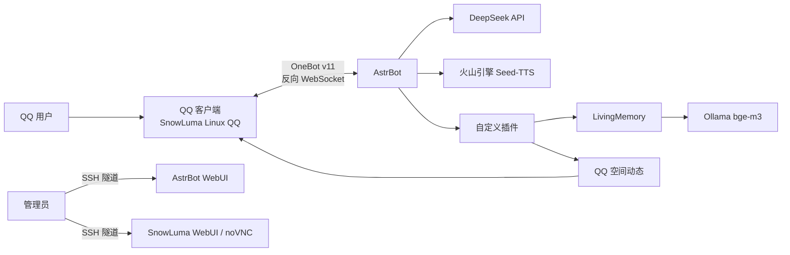

# 大肥鱼 QQ 机器人 · 云端版（可在本地部署）

> **使用声明**
>
> 本项目仅供个人学习、研究和个人非商业使用，不提供商业授权。
> 项目中涉及的第三方角色、声音、表情包、模型、代码和素材版权归各自原作者所有。
> 如权利人认为本项目内容侵权，请通过本仓库 Issue 联系，核实后将立即删除相关内容。
> 本项目与腾讯、DeepSeek、火山引擎、AstrBot、SnowLuma 等不存在隶属或官方授权关系。
>
> 详细声明见 [DISCLAIMER.md](DISCLAIMER.md)。

**当前版本：v1.5.0（稳定版）** · [更新日志](CHANGELOG.md) · [发行版](https://github.com/Automaticfly/emotional-dafeiyu-qq-chat-ai/releases) · [发版流程](RELEASING.md)

> **v1.5.0 稳定版**
>
> 本版把在线 B 站音乐接入、本地音乐库、Windows/Linux 安装流程和 B 站 412 修复
> 整合到一起。支持 Windows 10/11（Docker Desktop + WSL2）和 Linux
> （Ubuntu 22.04+ / Debian 12+）；本地原生 AstrBot 也可以使用。
>
> 音乐功能的完整说明、安装、补丁和排查见 [docs/MUSIC.md](docs/MUSIC.md)。

> **部署建议**
>
> 第一次部署建议让 AI 协助：把仓库链接、你的系统（Windows / Linux）和已经安装的软件发给 AI，
> 让它按 README 和 [docs/WINDOWS.md](docs/WINDOWS.md) 一步一步带你配置和排错。
> 不要把真实 API Key、QQ 号、密码、聊天记录或 `data/` 内容发给 AI。

一只住在 QQ 里的蓝色鲸鱼娘。她可以聊天、发语音、发表情包、记住重要的事，
也可以在 QQ 空间写一条不泄露隐私的日常动态。

这个仓库整理的是当前可运行版本的**功能代码、插件和部署骨架**，不包含任何
个人 API Key、QQ 号、聊天记录、记忆数据库、登录二维码或服务器凭据。

## 功能

### 对话与人格

- DeepSeek 文本对话
- 自定义人格提示词
- 按中文句号分段发送，模拟自然聊天节奏
- 根据当前心情附加 QQ 原生小黄脸
- 表情包按心情、语境和氛围自动匹配
- 群聊 / 私聊 / 唤醒词由 AstrBot 平台配置控制

### 语音

- 火山引擎豆包 Seed-TTS（声音复刻 2.0）
- 自定义克隆音色
- 当前会话默认只回文字，发送 `/语音开` 后文字 + 语音
- `/语音关`、`/语音状态`
- 支持使用 FeiyuVoice 参考音色重新训练云端音色

### 长期记忆

- LivingMemory 长期记忆插件
- Ollama `bge-m3` 1024 维向量检索
- 记忆重要性、时间衰减、反思总结
- 按会话隔离，避免把不同私聊/群聊的记忆混在一起

### 记忆 2.0

- 日记 2.0：模糊化、延长、升档/降档、搁置、回收站
- 主人画像
- 短期日程表
- 定时结算窗口

### 涟漪记忆

- 像日常琐事一样会变淡的记忆池
- 按类似艾宾浩斯曲线衰减：新鲜 → 中部 → 沉底
- 只有落在曲线中部的小事，被关键词或重复 4 个字撞见时才会被模糊地想起
- 沉底的小事被重新提到（重复字数够或语义相近）会勾回中部，下一次才有机会想起
- 想起时自动模糊时间、数字和细节，只保留「前两天 / 前阵子 / 好久以前」的印象
- 当天入池的事当天不触发
- 同一会话 90 分钟冷却，避免一直翻旧账
- 内置一整套屏蔽词（就是、今天、早上、吃饭等），也支持自定义特殊触发词
- 深夜自动摘录，也可以让她在聊天中自己记一件小事

### 心脏模块

- 关系认知
- 心情底色与动态心情
- 心绪手札
- 心情影响记忆召回和说话方式

### 媒体与表情包

- `/发图`
- `/表情`
- `/表情包`
- 100 张 Feiyu 风格 GIF 表情包
- 自动表情包：30% 触发，单次最多 2 条，永不连续 3 条
- 自动原生表情：约 50% 触发，其中一半跟随最后一段文字，一半独立发送
- 表情包/表情/图片独立成消息，不塞进文字气泡

### 相册

- 主人发来的照片自动收进相册
- 每张照片可以顺手补一句备注
- 按备注关键词翻找照片
- 可以让她把某张照片再发回来
- 按会话隔离，群友发图不会自动入库

### 抽屉

- **表情包抽屉**：自动收藏主人私聊/主人在群里发的 GIF 和小图，按 sha256 去重
- 支持 `/抽屉 表情包 [关键词]`，也可以让她用工具主动发
- **小事抽屉**：主人说「喜欢什么」「几点睡」「什么习惯」时当场记下
- 不需要等凌晨结算，也不用主人说第二遍
- 主人私聊时把相关小事注入 system prompt；群聊不注入，避免泄露
- `/抽屉`、`/抽屉 找`、`/抽屉 记`、`/抽屉 删`

### 耳朵

**在线音乐（插件市场，B 站）**

- 插件市场「我想听歌！」0.1.3，或「bili播放器」0.2.5
- 直接说「来一首晴天」「我想听永世的摇篮」，由模型选曲
- 也可以 `搜索歌曲 晴天`，再回复序号听歌，回复 `1 下载` 发文件
- 支持 BV / AV 号和 B 站视频链接
- 语音最长 15 分钟、25 MiB；下载单文件最大 100 MiB
- 未登录 B 站时可能被 412 拦截；本仓库提供
  `scripts/patch_music_plugin.py` 匿名 Cookie 补丁，安装后运行一次即可
- 详细说明、补丁步骤和排查见 [docs/MUSIC.md](docs/MUSIC.md)

**本地音乐库**

- `/本地点歌 <关键词>`、`/本地听歌`、`/本地歌单`、`/本地分享`
- 支持 mp3/flac/m4a/wav/ogg/aac/opus，可以建子目录
- 默认发文件，适合整首歌；可切换语音条或音乐卡片
- 可选接入 Meting API 在线搜索，默认关闭
- 主人分享 QQ 音乐卡片时，她会知道歌名并自然接一句，但不假装听过音频

两套命令和工具完全分开：

| 用途 | 命令 / 工具 |
|---|---|
| 在线/B 站点歌 | `搜索歌曲`；`find_music` / `deliver_music` / `search_music`（0.1.3） |
| 本地音乐 | `/本地*`；`local_music_play` / `local_music_search` |

### QQ 空间动态

- 手动发布文字/多图动态
- 权限支持公开、好友、私密
- `/动态查` 查询最近说说
- `/动态删` 删除最新动态
- `/动态预览` 预览自动生成的动态
- 每日自动动态：读取前一天 LivingMemory 的重要记忆，隐私过滤后发布
- 默认每天 09:30，默认好友可见，必要时可配置为私密

### 部署与安全

- 机器人账号建议使用 QQ 小号，大号通过 `/认主` 绑定为唯一主人
- 默认锁定 AstrBot / SnowLuma 镜像摘要，避免 latest 更新破坏核心补丁
- 容器带健康检查；更新前自动备份，启动失败自动回滚
- Docker Compose 管理 AstrBot + SnowLuma
- SnowLuma 使用真实 Linux QQ，支持 OneBot v11
- WebUI 和 noVNC 只绑定 `127.0.0.1`，通过 SSH 隧道访问
- Ollama 只监听 Docker 网关，不直接暴露公网
- 日志轮转、非 root 容器运行、seccomp/ptrace 按 SnowLuma 要求配置

## 兼容性

| 平台 | 支持方式 | 说明 |
|---|---|---|
| Linux | Docker Compose | Ubuntu 22.04+ / Debian 12+，推荐云服务器 |
| Windows 10/11 | Docker Desktop + WSL2 | 使用 `docker-compose.windows.yml`，无需安装 Windows 版 QQ |
| Windows / Linux 原生 | 已有 AstrBot | 用 `inject.sh` / `inject.ps1` 注入，或手动复制插件 |

- 在线音乐插件要求 AstrBot `>=4.26,<5`，当前镜像为 4.29.x
- 在线音乐需要容器内 `ffmpeg`；官方镜像已包含
- 本地音乐不依赖 B 站，也不依赖在线插件

## 技术栈

| 层 | 技术 |
|---|---|
| 机器人框架 | AstrBot 4.29.x（默认锁定镜像摘要） |
| QQ 协议端 | SnowLuma（Linux QQ + Xvfb + noVNC + OneBot v11） |
| 对话模型 | DeepSeek |
| 语音合成 | 火山引擎豆包 Seed-TTS / 声音复刻 2.0 |
| 语音音色 | FeiyuVoice-CosyVoice3 参考音色（云端复刻版本） |
| 向量模型 | Ollama `bge-m3` |
| 长期记忆 | LivingMemory |
| 在线音乐 | Bilibili（插件市场「我想听歌！」/「bili播放器」+ ffmpeg） |
| 插件语言 | Python 3.10+（运行时 3.12） |
| 数据 | SQLite / aiosqlite |
| 编排 | Docker Compose |
| 部署 | Linux（Ubuntu 22.04+ / Debian 12+）；Windows 10/11（Docker Desktop + WSL2） |

## 架构



在线音乐链路：

```text
AstrBot → 在线音乐插件 → Bilibili 搜索/音频 → ffmpeg → QQ 语音或文件
```

更详细的组件边界、数据流和插件职责见 [ARCHITECTURE.md](ARCHITECTURE.md)，
音乐部分见 [docs/MUSIC.md](docs/MUSIC.md)。

## 仓库结构

```text
.
├── docker-compose.yml            # Linux / 云端部署
├── docker-compose.windows.yml    # Windows 本地部署（去掉 Linux 专用挂载）
├── Dockerfile.astrbot            # 带核心补丁的 AstrBot 镜像
├── patches/
│   ├── volcengine_tts.py         # 豆包 Seed-TTS v3 适配
│   ├── session_llm_manager.py    # 默认关闭 TTS，/语音开 开启
│   └── respond_stage.py          # 分段发送 + 内联原生表情
├── plugins/
│   ├── astrbot_plugin_dafeiyu_heart/
│   ├── astrbot_plugin_dafeiyu_memory2/
│   ├── astrbot_plugin_dafeiyu_ripple/
│   ├── astrbot_plugin_dafeiyu_owner/
│   ├── astrbot_plugin_dafeiyu_drawer/
│   ├── astrbot_plugin_dafeiyu_ears/
│   ├── astrbot_plugin_dafeiyu_context/
│   ├── astrbot_plugin_dafeiyu_social/
│   ├── astrbot_plugin_dafeiyu_moodface/
│   ├── astrbot_plugin_face_convert/
│   └── astrbot_plugin_livingmemory/
├── persona/
│   └── dafeiyu.md                # 已移除私人信息的公开人格模板
├── config/
│   ├── snowluma-onebot.example.json
│   ├── social.example.json
│   ├── ripple.example.json
│   └── CONFIGURATION.md
├── assets/stickers/dafeiyu/      # 100 张 GIF 及分类目录
├── docs/
│   ├── WINDOWS.md                # Windows 本地部署指南
│   ├── INCREMENTAL.md            # 增量注入与底层加固
│   └── MUSIC.md                  # 在线 B 站 + 本地音乐完整说明
└── scripts/
    ├── install.sh / install.ps1  # Linux / Windows 安装
    ├── update.sh / update.ps1    # 更新
    ├── uninstall.sh / uninstall.ps1
    ├── inject.sh / inject.ps1    # 增量注入
    └── patch_music_plugin.py     # B 站 412 兼容补丁
```

> **说明**
>
> 在线音乐插件「我想听歌！」/「bili播放器」来自 AstrBot 插件市场，
> 不在本仓库内。本仓库只提供安装说明和兼容补丁。

## 快速开始

### 0. 下载代码

推荐用 Git：

```bash
git clone https://github.com/Automaticfly/emotional-dafeiyu-qq-chat-ai.git
cd emotional-dafeiyu-qq-chat-ai
```

没有安装 Git 时，打开仓库页面 → **Code → Download ZIP**，或到
[Releases](https://github.com/Automaticfly/emotional-dafeiyu-qq-chat-ai/releases)
下载 `Source code (zip)`，解压后进入目录。

下载完成后确认目录里有：

```text
docker-compose.yml
docker-compose.windows.yml
scripts/
plugins/
```

> **提示**
>
> 不要直接在 ZIP 压缩包里运行脚本，要先解压。路径里尽量不要有中文和空格，
> 避免 Docker 挂载和脚本路径出错。

### 1. 准备环境

| 平台 | 要求 |
|---|---|
| Linux | Ubuntu 22.04+ / Debian 12+，Docker Engine + Compose v2，建议 4GB+ 内存、10GB+ 磁盘 |
| Windows | Windows 10 2004+ / Windows 11，Docker Desktop（WSL2 后端），建议 8GB+ 内存、10GB+ 磁盘 |
| 通用 | 能访问 GitHub、Docker Hub、DeepSeek / 火山引擎 / Bilibili；可选 Ollama |
| 端口 | 本机 `6185`（AstrBot）、`5099`（SnowLuma）、`6081`（noVNC） |

Windows 的完整前置条件、WSL2 设置和排错见 [docs/WINDOWS.md](docs/WINDOWS.md)。

### 2. 启动

```bash
bash scripts/install.sh
```

安装脚本会自动生成 `.env`、创建数据目录、构建并启动容器，并把初始账号密码保存到
`data/INITIAL_CREDENTIALS.txt`。权限不足时用 `sudo bash scripts/install.sh`。

首次启动后：

1. 打开 AstrBot WebUI：`http://127.0.0.1:6185`
2. 新建 OneBot v11 平台，建议 ID 使用 `napcat`
3. 反向 WebSocket 地址填 `0.0.0.0:6199`，设置一个 token
4. 配置 DeepSeek、TTS、Ollama 等 provider
5. 按 [CONFIGURATION.md](config/CONFIGURATION.md) 配置插件管理员和 UMO
6. 打开 SnowLuma WebUI：`http://127.0.0.1:5099`
7. 通过 noVNC 扫码登录 QQ
8. 将 SnowLuma 的 `onebot.json` token 改成与 AstrBot 平台 token 一致

### 3. 安装在线音乐（推荐）

1. 打开 AstrBot WebUI → 插件市场
2. 搜索并安装「我想听歌！」0.1.3，或「bili播放器」0.2.5（只装一个）
3. 在项目根目录运行 412 兼容补丁：

```bash
docker cp scripts/patch_music_plugin.py astrbot:/tmp/patch_music_plugin.py
docker compose exec astrbot python /tmp/patch_music_plugin.py --path /AstrBot/data
docker compose restart astrbot
```

Windows 使用：

```powershell
docker cp scripts\patch_music_plugin.py astrbot:/tmp/patch_music_plugin.py
docker compose -f docker-compose.windows.yml exec astrbot python /tmp/patch_music_plugin.py --path /AstrBot/data
docker compose -f docker-compose.windows.yml restart astrbot
```

4. 在 QQ 里发 `搜索歌曲 晴天`，回复 `1` 测试

完整说明、0.1.3 与 0.2.5 的区别、B 站登录和排查见 [docs/MUSIC.md](docs/MUSIC.md)。

### 4. 导入人格

把 [persona/dafeiyu.md](persona/dafeiyu.md) 的正文导入 AstrBot 人格设置。

### 5. 初始化记忆和向量模型

```bash
ollama pull bge-m3
```

并将 AstrBot 的 embedding provider 指向：

```text
http://host.docker.internal:11434
```

具体配置见 [CONFIGURATION.md](config/CONFIGURATION.md)。

## 安装、更新与卸载

### 安装

```bash
bash scripts/install.sh
```

安装脚本会自动：

1. 检查 Docker 和目录权限
2. 创建 `data/` 目录
3. 生成 `.env`；如果没改 VNC 占位密码，会自动生成一个随机密码
4. 复制表情包素材和 SnowLuma OneBot 配置
5. 构建并启动 AstrBot + SnowLuma
6. 把初始账号密码保存到 `data/INITIAL_CREDENTIALS.txt`

初始账号密码：

```text
AstrBot    用户名 astrbot，密码随机生成
SnowLuma   用户名 admin，密码随机生成
noVNC      密码在 .env 的 VNC_PASSWORD
```

三个密码都会写进 `data/INITIAL_CREDENTIALS.txt`（权限 600）。登录后请立即修改密码并删除该文件。

> **提示**
>
> 在线音乐插件「我想听歌！」/「bili播放器」不在本仓库内，需要安装后从插件市场
> 单独安装，并运行一次 412 补丁。完整步骤见 [docs/MUSIC.md](docs/MUSIC.md)。

### 绑定主人

机器人账号建议使用 **QQ 小号**，你的大号用来认主和日常聊天。

1. 用大号先加机器人小号为好友
2. 用大号私聊机器人，发送：

```text
/认主 你的QQ号
```

3. 机器人会校验「发送者 QQ」和「填写的 QQ」是否一致
4. 接着设置换主密码：

```text
/认主 密码 你的密码
```

密码要求 8-64 位，至少包含一个字母和一个数字，不能是纯数字或和 QQ 相同。

5. 绑定成功后自动写入插件配置和 AstrBot 管理员列表，并重启一次

以后需要换主时，新号本人私聊机器人：

```text
/认主 更换 新QQ 换主密码
```

验证通过后会清除旧 QQ 的管理权限，再绑定新 QQ。

其他命令：

```text
/认主 改密码 旧密码 新密码   修改换主密码
/认主 状态                   查看当前主人和密码状态
```

认主后会写入：

- `social`：`admin_qq`、`admin_umo`、`qzone_auto_umo`
- `ripple`：`admin_qq`、`admin_umo`
- `memory2` / `heart`：`main_umo`
- AstrBot：`admins_id`
- `data/owner.json`：绑定记录和密码哈希

群里发 `/认主` 会被拒绝；已经绑定后，其他 QQ 不能覆盖。
密码只保存哈希，不保存明文；连续输错 5 次会锁定 10 分钟。

认主后，机器人在私聊里会知道当前是主人；主人在群里发言时也知道，但不会向群友透露身份和私聊内容。

如果认主后还是不认识：

1. 用主人号私聊发送 `/reset` 清除当前会话上下文
2. 再问一次「主人是谁」
3. 还不行就把 `/认主 状态` 的输出和报错发给 AI 求助
4. 不要把密码、API Key、完整 QQ 号或 `data/` 内容发给 AI

如果出现权限问题：

```text
permission denied
Cannot connect to the Docker daemon
```

用 sudo 重新运行：

```bash
sudo bash scripts/install.sh
```

或者把用户加入 docker 组：

```bash
sudo usermod -aG docker $USER
newgrp docker
```

### Windows 本地部署

Windows 上用 Docker Desktop（WSL2 后端）运行，不需要云服务器。

前置条件：

- Windows 10 2004+ 或 Windows 11
- Docker Desktop，启用 WSL2 后端，鲸鱼图标变绿
- 建议 8GB 以上内存、10GB 以上磁盘
- 已开启 CPU 虚拟化

安装：

```powershell
powershell -ExecutionPolicy Bypass -File scripts\install.ps1
```

脚本会自动创建 `data\`、生成 `.env`、构建并启动容器，初始账号密码保存在：

```text
data\INITIAL_CREDENTIALS.txt
```

打开：

```text
http://127.0.0.1:6185          AstrBot
http://127.0.0.1:5099          SnowLuma
http://127.0.0.1:6081/vnc.html?autoconnect=1   noVNC
```

在线音乐插件安装后，在项目根目录运行补丁：

```powershell
docker cp scripts\patch_music_plugin.py astrbot:/tmp/patch_music_plugin.py
docker compose -f docker-compose.windows.yml exec astrbot python /tmp/patch_music_plugin.py --path /AstrBot/data
docker compose -f docker-compose.windows.yml restart astrbot
```

日常更新 / 卸载：

```powershell
# 检查更新
powershell -ExecutionPolicy Bypass -File scripts\update.ps1 -Check

# 更新
powershell -ExecutionPolicy Bypass -File scripts\update.ps1

# 卸载（保留 data\ 和 .env）
powershell -ExecutionPolicy Bypass -File scripts\uninstall.ps1

# 卸载并删除数据
powershell -ExecutionPolicy Bypass -File scripts\uninstall.ps1 -Purge

# 卸载并删除镜像
powershell -ExecutionPolicy Bypass -File scripts\uninstall.ps1 -RemoveImages
```

- 使用 `docker-compose.windows.yml`，去掉了 Linux 专用的 `/etc/localtime` 挂载
- Windows compose 把仓库的 `plugins\` 直接挂到容器的 `/AstrBot/data/plugins`
- 市场安装的第三方插件会出现在 `plugins\`，不要提交到 Git 仓库
- 也可以用 Git Bash 运行 `bash scripts/install.sh`
- 详细步骤、Ollama 配置、端口排查见 [docs/WINDOWS.md](docs/WINDOWS.md)

### 增量安装到已有 AstrBot + SnowLuma

如果已经有一套能运行的 AstrBot + SnowLuma，不需要重装，只注入大肥鱼层：

```bash
bash scripts/inject.sh --path /opt/astrbot
```

Windows：

```powershell
powershell -ExecutionPolicy Bypass -File scripts\inject.ps1 -Path D:\dafeiyu
```

- 只补插件、补丁、人格模板和配置示例
- 不碰 `data/config`、`cmd_config.json`、`.env` 和用户 compose
- 自动备份到 `backups/inject-<时间>/`
- 注入后重启并做健康检查，失败自动回滚
- 在线音乐插件需要另外从市场安装，并运行 412 补丁；见 [docs/MUSIC.md](docs/MUSIC.md)
- 详细说明见 [docs/INCREMENTAL.md](docs/INCREMENTAL.md)

### 更新

Linux：

```bash
bash scripts/update.sh          # 同步 GitHub 最新代码并重启
bash scripts/update.sh --check  # 只看有没有新版本
```

Windows：

```powershell
powershell -ExecutionPolicy Bypass -File scripts\update.ps1 -Check
powershell -ExecutionPolicy Bypass -File scripts\update.ps1
```

- `git clone` 的部署：`git fetch` + 快进合并
- 下载 zip 的部署：从 GitHub 拉取压缩包，只替换代码和插件
- 始终保留 `data/`、`.env`，以及你自己放进 `plugins/` / `data/plugins/` 的额外插件
- 旧文件备份到 `backups/update-<时间>/`
- 在线音乐插件如果被市场更新，412 补丁可能被覆盖；更新后重新运行
  `scripts/patch_music_plugin.py`，再重启 AstrBot

更新时如果提示权限不足，Linux 用 `sudo bash scripts/update.sh`，或先加入 docker 组。

每天自动同步：

```cron
30 4 * * * cd /opt/astrbot && bash scripts/update.sh --auto >> update.log 2>&1
```

### 卸载

Linux：

```bash
bash scripts/uninstall.sh                 # 停容器，保留 data/ 和 .env
bash scripts/uninstall.sh -y              # 不询问
bash scripts/uninstall.sh --purge         # 连 data/、.env 一起删除
bash scripts/uninstall.sh --remove-images # 同时删除项目镜像
```

Windows：

```powershell
powershell -ExecutionPolicy Bypass -File scripts\uninstall.ps1
powershell -ExecutionPolicy Bypass -File scripts\uninstall.ps1 -Purge
powershell -ExecutionPolicy Bypass -File scripts\uninstall.ps1 -RemoveImages
```

卸载范围：

| 操作 | 容器 | `data/` | `.env` | 镜像 | `backups/` |
|---|---|---|---|---|---|
| 默认 | 删除 | 保留 | 保留 | 保留 | 保留 |
| `--purge` / `-Purge` | 删除 | 删除 | 删除 | 保留 | 保留 |
| `--remove-images` / `-RemoveImages` | 删除 | 保留 | 保留 | 删除 | 保留 |

> **警告**
>
> `--purge` 会删除聊天记录、长期记忆、涟漪池、相册、QQ 登录态和本地音乐库，
> 执行前请先备份 `data/`。

程序目录本身不会被删除。彻底清理 Linux：

```bash
rm -rf /opt/astrbot
```

Windows 删除整个项目文件夹即可。完整选项、cron/systemd 示例和排查方法见
[scripts/README.md](scripts/README.md)。

## 命令

完整命令见 [COMMANDS.md](COMMANDS.md)。常用命令：

```text
/语音开        开启当前会话语音
/语音关        关闭当前会话语音
/心            查看心情与关系
/手札          查看心绪手札
/日记2         查看日记
/画像          查看主人画像
/日程          查看日程
/涟漪          查看涟漪池状态
/涟漪 列表     查看池子里的小事
/涟漪 摘录     立刻摘一次最近聊天
/涟漪 记       手动放一件小事进池子
/认主          用大号私聊绑定主人
/抽屉          查看抽屉
/抽屉 表情包   发一张收藏的表情包
搜索歌曲 晴天  在线 B 站搜索（插件市场）
1              选择第 1 首并发送语音
1 下载         下载第 1 首音频文件
/本地点歌      本地音乐库点歌
/本地听歌      随机本地歌曲
/本地分享      分享本地歌曲
/相册          查看相册和备注
/相册备注      给最新一张照片加一句备注
/上下文        查看最近上下文
/发图          发送图片
/表情          发送 QQ 原生表情
/表情包        发送表情包
/动态          发布 QQ 空间动态
/动态预览      预览自动动态
/动态自动      查看自动动态配置
```

> **提示**
>
> `搜索歌曲`、序号选择、`1 下载` 由插件市场的在线音乐插件提供，需要先安装并
> 打 412 补丁；`/本地*` 由本仓库的耳朵插件提供，不需要在线插件。
> 两套命令可以同时使用。完整说明见 [docs/MUSIC.md](docs/MUSIC.md)。

## 音乐常见问题

| 现象 | 先检查 |
|---|---|
| 有些歌提示“没有找到可播放版本” | 是否运行了 412 补丁；换日文原名/歌手名重搜 |
| 搜索有结果但发不出语音 | 容器内 `ffmpeg -version`；改回 `1 下载` 试文件 |
| 两个音乐插件抢命令 | 只保留 0.1.3「我想听歌！」或 0.2.5「bili播放器」其中一个 |
| 本地歌单 0 首 | 音频是否放进 `data/plugin_data/astrbot_plugin_dafeiyu_ears/music/` |
| 更新插件后又找不到 | 重新运行 `scripts/patch_music_plugin.py` 并重启 |

更多排查见 [docs/MUSIC.md](docs/MUSIC.md)。

## 仓库不包含的依赖

- AstrBot 和 SnowLuma 的完整源码：使用官方镜像
- 在线音乐插件「我想听歌！」/「bili播放器」：从 AstrBot 插件市场安装，仓库只带兼容补丁脚本
- FeiyuVoice-CosyVoice3 的 7.4GB 本地权重：当前部署使用云端声音复刻
- Ollama 模型文件：通过 `ollama pull bge-m3` 获取
- 任何真实账号、密钥、聊天记录或记忆数据库

## 数据与隐私

这个仓库**不包含**：

- DeepSeek / 火山引擎 / 其他 API Key
- QQ 号、管理员账号、UMO、token
- `data_v4.db`、聊天记录、LivingMemory 数据库
- `plugin_data`、日记、画像、日程、心绪手札、涟漪池
- 相册照片和照片备注
- 本地音乐库里的歌曲文件
- 在线音乐插件的 B 站 Cookie、登录态或二维码
- `data/INITIAL_CREDENTIALS.txt`（初始账号密码）
- 登录二维码、语音样本、日志、截图
- 个人服务器 IP、SSH 密钥、密码

运行时数据全部放在 `data/`，该目录已被 `.gitignore` 排除。详见
[PRIVACY.md](PRIVACY.md)。

## 第三方组件与许可

本项目原创代码和文档采用**个人非商业使用许可**，不允许商业使用；具体见
[LICENSE](LICENSE) 和 [DISCLAIMER.md](DISCLAIMER.md)。AstrBot、SnowLuma、
LivingMemory、FeiyuVoice、表情包素材等第三方组件分别遵循各自许可，详见
[THIRD_PARTY_NOTICES.md](THIRD_PARTY_NOTICES.md)。

- AstrBot：<https://github.com/AstrBotDevs/AstrBot>
- SnowLuma：<https://github.com/SnowLuma/SnowLuma>
- 在线音乐插件「我想听歌！」/「bili播放器」：<https://github.com/57Darling02/astrbot_plugin_bili_player>
- LivingMemory：<https://github.com/lxfight-s-Astrbot-Plugins/astrbot_plugin_livingmemory>
- FeiyuVoice：<https://github.com/Esmerubphire/astrbot_plugin_feiyu_voice>
- 表情包：<https://github.com/diwer/ai-biaoqingbao>

表情包与 FeiyuVoice 素材仅建议个人非商业使用；商用前请自行确认授权。
